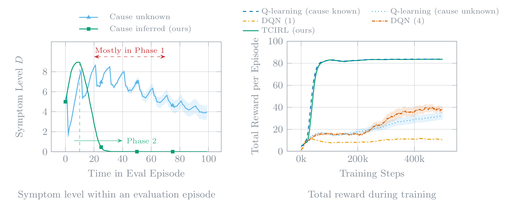

# TCIRL: Temporal-Causal Inference for Reinforcement Learning

[](https://arxiv.org/abs/2609.07461)
[](https://arxiv.org/abs/2609.07461)
[](https://www.python.org/)
[](LICENSE)

Reinforcement learning when the rules of the environment change after a hidden sequence of events.

<p align="center">
  <picture>
    <source media="(prefers-color-scheme: dark)" srcset="docs/figures/genetic-therapy-dark.png">
    <source media="(prefers-color-scheme: light)" srcset="docs/figures/genetic-therapy-light.png">
    
  </picture>
</p>

<p align="center"><sub>Genetic therapy: TCIRL learns to trigger the hidden cause, after which the symptoms fall (left), and it ends level with Q-learning that observes the cause state (right).</sub></p>

TCIRL is a reinforcement learning algorithm for tasks whose dynamics depend on the history of events.
In such tasks, if a hidden temporal pattern of events occurs, the dynamics permanently switch from *Phase 1* to *Phase 2*.
For example, in genetic therapy, a treatment may start to work only after the right genetic modifications in the right order, which form the *cause* of the switch.
The agent never sees the phase, only occasional *markers*: events like a spontaneous recovery that happen in one phase but never in the other.

A standard RL agent learns to treat the symptoms, while TCIRL learns to treat their hidden cause.
It infers the cause as a deterministic finite automaton (DFA) while it learns the policy, and in both case studies it recovers the correct cause and matches an agent that observes the cause from the start.

At a high level, TCIRL interleaves reinforcement learning with automata learning:

1. Start from a trivial hypothesis DFA, which says that the cause never occurs.
2. Run RL episodes on the observed state together with the state of the hypothesis DFA.
3. If the markers of an episode contradict the current hypothesis, record its trace in a set of counterexamples.
4. Periodically, use a SAT solver to synthesize the smallest DFA consistent with all counterexamples discovered thus far.

The paper proves that the hypothesis converges almost surely to a DFA whose language induces the same dynamics as the cause, and that the policy converges to an optimal one.

## Case studies

| | genetic therapy | traffic signal |
| --- | --- | --- |
| state | position on a 5x5 grid, symptom level, harm level | three queues of cars, the red light, a cooldown |
| hidden cause | visit gene sites G1, G2, G1, G4 in this order | three consecutive hold-advance cycles of the lights |
| Phase 2 | symptoms recede, so the agent should trigger the cause | arrivals become bursty, so the agent should avoid the cause |
| markers | a symptom increase (Phase 1), a spontaneous recovery (Phase 2) | 2 or more cars leave the last queue in one step (Phase 1), 2 or more arrive at the first (Phase 2) |

TCIRL matches Q-learning that observes the true cause state in both domains, and it outperforms Q-learning without the cause state and a Double DQN over a window of the last four frames or of the current frame alone.
Final evaluation return per episode (out of 100, mean over 50 seeds):

| | TCIRL | Q-learning, cause known | Q-learning, cause unknown | DQN (4 frames) | DQN (1 frame) |
| --- | --- | --- | --- | --- | --- |
| genetic therapy | 83.6 | 83.7 | 32.0 | 38.1 | 10.6 |
| traffic signal | 64.2 | 64.3 | 21.2 | 46.1 | 29.3 |

## Installation

The project needs Python 3.13, [uv](https://docs.astral.sh/uv/), and Graphviz's `dot` program, which renders the learned automata.

```bash
uv sync                  # CPU only
uv sync --extra cuda     # with JAX for CUDA 12 GPUs
```

A short two-seed run on the CPU checks the installation:

```bash
JAX_PLATFORMS=cpu PYTHONHASHSEED=43 uv run train_gene_editing_tcirl --config_path config/gene_editing_tcirl.yaml \
    --noupload --num_runs 2 --total_steps 20000 --num_eval_points 21
```

## Training an agent

Each command trains 50 seeds in one process and logs to [Weights & Biases](https://wandb.ai), or offline with `--noupload`.
`PYTHONHASHSEED` must equal the configuration's `run.seed`, which is 43 in every shipped file.

```bash
export PYTHONHASHSEED=43 XLA_FLAGS=--xla_gpu_autotune_level=0 WANDB_ENTITY=<your W&B entity>
uv run train_gene_editing_tcirl --config_path config/gene_editing_tcirl.yaml
uv run train_traffic_tcirl --config_path config/traffic_signal_tcirl.yaml
uv run train_gene_editing_q_learning --config_path config/gene_editing_q_learning.yaml --cause_known
uv run train_traffic_dqn --config_path config/traffic_signal_dqn.yaml
```

A command-line option overrides the configuration file, for example `--num_runs 5` or `--project my-project`.
A shorter run needs a matching evaluation grid, such as `--total_steps 200000 --num_eval_points 201`.

## Reproducing the paper

```bash
uv sync --extra cuda
uv run wandb login
export CUDA_DEVICE_ORDER=PCI_BUS_ID CUDA_VISIBLE_DEVICES=0,1
export WANDB_ENTITY=<your W&B entity>
scripts/reproduce_paper.sh <suffix>
```

The script trains nine arms in both case studies, the paper's five agents and four ablations, in about an hour on two A100 GPUs.
It writes every per-seed curve to `tmp/results/` and the data of the paper's figures and tables to `tmp/paper_results/results/`.
It runs from a clean commit of `main`, which every result records.
Without a W&B account, run it offline with `TCIRL_TRAIN_ARGS=--noupload`.

The paper's cycle benchmarks in traffic compute the exact returns of fixed light cycles, on a CPU and without training:

```bash
bash scripts/traffic_signal/cadence.sh tmp/traffic_cadence
```

These environment variables adjust the pipeline:

| variable                                    | effect                                                                                     |
| ------------------------------------------- | ------------------------------------------------------------------------------------------ |
| `CUDA_DEVICE_ORDER`, `CUDA_VISIBLE_DEVICES` | the GPUs, as indices in `PCI_BUS_ID` order; by default each card runs one arm at a time   |
| `TCIRL_RUNS`                                | seeds per arm (default 50)                                                                 |
| `TCIRL_JOBS`                                | parallel runs                                                                              |
| `TCIRL_LIMIT`                               | train only the first n arms, too few for the paper's figures and tables                    |
| `TCIRL_TRAIN_ARGS`                          | extra options for every training command                                                   |
| `TCIRL_EXPORT_SNAPSHOT`                     | name of the export snapshot directory                                                      |
| `TCIRL_PAPER_RESULTS_DIR`                   | write the data of the paper's figures and tables to `$TCIRL_PAPER_RESULTS_DIR/results/`    |
| `TCIRL_MAIN_SOURCE`                         | a repository, as a path or a URL, whose `main` must contain the commit                     |
| `ALLOW_DIRTY=1`                             | skip the clean-commit check                                                                |

## Repository layout

| path                                                | contents                                                                |
| --------------------------------------------------- | ----------------------------------------------------------------------- |
| `src/tcirl/agents/`                                 | TCIRL and the DQN baseline                                              |
| `src/tcirl/envs/`                                   | the genetic-therapy gridworld and the traffic-signal pipeline           |
| `src/tcirl/specifications/`                         | the hidden causes and the marker alphabets of both case studies         |
| `src/tcirl/inference/`                              | the counterexample check and the SAT synthesis of the cause DFA         |
| `src/tcirl/rl/`                                     | tabular Q-learning, the DQN iteration, and the greedy evaluation        |
| `src/tcirl/metrics/`, `src/tcirl/logging/`          | metric definitions, the bootstrap statistics, and the per-seed records  |
| `src/tcirl/export.py`, `src/tcirl/paper_results.py` | the export of per-seed curves and the data of the paper's figures       |
| `config/`                                           | the configurations of every agent in both case studies                  |
| `data/grids/`                                       | the gridworld map                                                       |
| `scripts/`                                          | the reproduction pipeline                                               |

## Citation

```bibtex
@misc{corazza2026temporalcausalinferencereinforcementlearning,
      title={Temporal-Causal Inference for Reinforcement Learning via Automata Learning},
      author={Jan Corazza and Daniil Kaminskyi and Simon Lutz and Patrick Nossol and Hadi Partovi Aria and Zhe Xu and Daniel Neider},
      year={2026},
      eprint={2609.07461},
      archivePrefix={arXiv},
      primaryClass={cs.LG},
      url={https://arxiv.org/abs/2609.07461},
}
```

## License

MIT; see [LICENSE](LICENSE).
